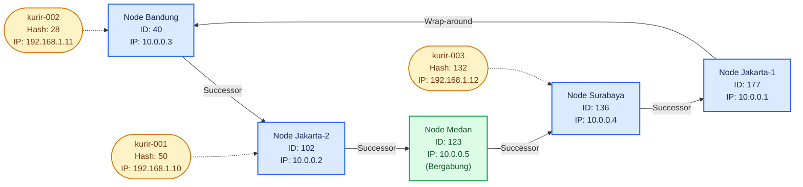

# Tugas 6 (Pekan 6) — Penamaan & Resolusi Lokasi

**Materi terkait:** Flat Naming, Structured Naming (DNS), Distributed Hash Table (DHT)/Chord.

**Kelompok:** [Kelompok 5]

| Nama | NIM |
|---|---|
| [Bethari Nevyta Amaries] | [103072430016] |
| [A'ilah Nailul Fa'izah] | [103072400042] |

## Studi Kasus

Pelanggan FoodGo kesulitan menemukan alamat IP server kurir yang **dinamis** (kurir berpindah lokasi/jaringan, IP-nya sering berubah). FoodGo butuh cara memetakan **ID Kurir** (identitas tetap) ke **alamat IP terkininya** tanpa server pusat tunggal yang jadi bottleneck/single point of failure.

## Penjelasan DHT/Chord vs. flat naming dan DNS
Flat naming menggunakan ID yang tidak menunjukkan lokasi kurir, seperti kurir-001, sehingga diperlukan sistem untuk mencari alamat IP yang sesuai. Jika hanya menggunakan satu server pusat, pencarian bisa terganggu ketika server bermasalah atau menerima terlalu banyak permintaan. DHT (Distributed Hash Table) mengatasi hal ini dengan membagi penyimpanan data ke beberapa komputer. Chord merupakan salah satu penerapan DHT yang menyimpan data berdasarkan hasil hash dalam bentuk lingkaran atau ring. Pada simulasi ini, ID berada pada rentang 0 sampai 255 (M_BITS = 8). Setiap key (ID kurir) disimpan pada node successor-nya, yaitu node pertama yang ID-nya lebih besar atau sama dengan hash key tersebut. Jika tidak ada node yang memenuhi syarat itu, pencarian kembali ke node dengan ID terkecil (wrap-around). Ketika node bergabung atau keluar, hanya key di sekitar node itu yang dialihkan ke node lain. Simulasi ini menggunakan daftar node terurut agar proses pencarian lebih sederhana, sedangkan Chord asli memakai finger table.

DNS menggunakan nama bertingkat, seperti id.co.foodgo.com, dan dilayani server dengan hierarki root, TLD, dan authoritative. Sementara itu, Chord membagi data ke banyak node yang setara tanpa bergantung pada satu server pusat. Untuk skenario FoodGo, Chord cocok dipertimbangkan karena alamat IP kurir bisa berubah dan jumlah kurir dapat bertambah. Dengan begitu, beban pencarian terbagi dan data tetap bisa ditemukan ketika salah satu node mengalami gangguan.

## Diagram ring topology

## Penjelasan node keluar
Saat sebuah node keluar melalui `leave()`, program mencari key yang dipegang node tersebut, menghapusnya dari ring, lalu memindahkan key itu ke successor barunya. Perpindahan ini ditampilkan melalui log `[TRANSFER LEAVE]`. Pada output di bawah, node-medan-1 (ID 123) bergabung tanpa memindahkan data karena tidak ada key yang menjadi tanggung jawabnya, dan node-jakarta-1 (ID 177) keluar tanpa perpindahan karena memang tidak menyimpan key apa pun. Perpindahan baru terjadi saat node-bandung-1 (ID 40) keluar, karena node ini menyimpan key 28 milik `kurir-002`. Key tersebut dialihkan ke node-jakarta-2 (ID 102), dan `lookup("kurir-002")` tetap mengembalikan IP `192.168.1.11`. Artinya data kurir tetap dapat ditemukan meskipun node yang menyimpannya keluar dari ring.

## Tugas Kelompok

Implementasikan **simulasi Chord DHT** sederhana (single-process, tidak perlu jaringan sungguhan — cukup simulasi struktur data & algoritma di satu program Python) yang memetakan ID Kurir ke alamat IP mereka.

Konsep yang harus terlihat jalan dalam simulasi kalian:
1. **Consistent hashing**: ID Kurir dan ID Node di-hash ke ruang angka yang sama (mis. 0–255 untuk kesederhanaan, `m=8` bit).
2. **Ring topology**: node-node diurutkan melingkar berdasarkan hasil hash-nya.
3. **Lookup**: fungsi `lookup(kurir_id)` yang menemukan node mana yang bertanggung jawab menyimpan mapping ID Kurir tersebut → alamat IP-nya (aturan Chord: node dengan ID hash **terkecil yang lebih besar atau sama dengan** hash key, disebut *successor*).
4. **Perubahan topologi**: simulasikan minimal satu node baru bergabung (`join`) atau satu node keluar (`leave`), tunjukkan bagaimana mapping berpindah tanggung jawab ke node lain.

Skeleton disediakan di `src/chord_simulation.py` dengan fungsi hashing dan struktur ring sudah ada — bagian `lookup()`, `join()`, dan `leave()` sengaja dikosongkan.

### Cara Menjalankan

```bash
python3 src/chord_simulation.py
```

## Tugas Analisis (`README.md`)

1. Jelaskan **kenapa DHT/Chord** lebih cocok untuk kasus ini dibanding **flat naming sederhana** (mis. tabel pusat ID→IP) atau **DNS konvensional** — kaitkan dengan sifat "IP kurir sering berubah" dan kebutuhan tanpa titik gagal tunggal.
2. Gambarkan (boleh pakai Mermaid, lihat Tugas 2) ring topology dari simulasi kalian, tandai node mana yang bertanggung jawab atas ID Kurir mana.
3. Jelaskan apa yang terjadi pada mapping saat sebuah node **keluar** dari ring (siapa yang mengambil alih tanggung jawabnya) — dukung dengan output program.

## Struktur Submission

```
tugas-06-penamaan-dht/
├── README.md      # Analisis + diagram ring
├── JURNAL.md
├── src/
│   └── chord_simulation.py
└── bukti/          # Output program (screenshot/log) untuk skenario join & leave
```

## Rubrik Penilaian (Tugas 6)

| Komponen | Bobot | Kriteria |
|---|---|---|
| Implementasi lookup/join/leave benar | 35% | Consistent hashing & successor lookup sesuai aturan Chord |
| Bukti perubahan topologi (join/leave) | 25% | Output menunjukkan mapping berpindah dengan benar |
| Analisis kenapa DHT vs flat naming/DNS | 25% | Argumen spesifik ke kasus IP kurir dinamis, bukan definisi umum |
| Proses & kontribusi kelompok | 15% | `JURNAL.md`, commit history |

## Batasan Penggunaan AI (Level 2)

Kebijakan **Level 2 (AI Assisted Idea Generation & Structuring)** berlaku — lihat [`../RUBRIK-UMUM.md`](../RUBRIK-UMUM.md). Boleh bertanya konsep umum consistent hashing/Chord ke AI; **tidak boleh** meminta AI menuliskan isi `# TODO` di `src/chord_simulation.py` (`find_successor`, `join`, `leave`, dst). Catat pemakaian AI di "Log Penggunaan AI" pada `JURNAL.md`.

- `README.md` wajib menelusuri manual (langkah demi langkah) bagaimana `lookup()` menemukan successor untuk salah satu ID Kurir contoh yang dipakai di `chord_simulation.py` — bukan cuma menempelkan output program.
