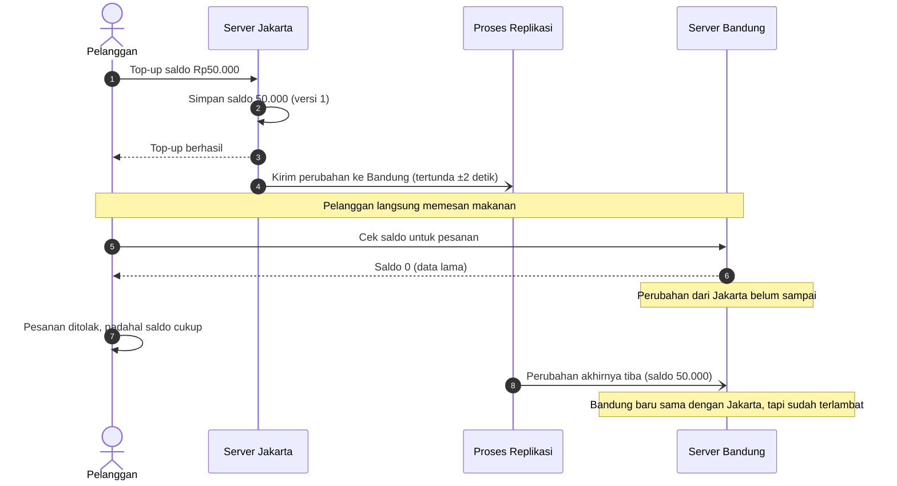
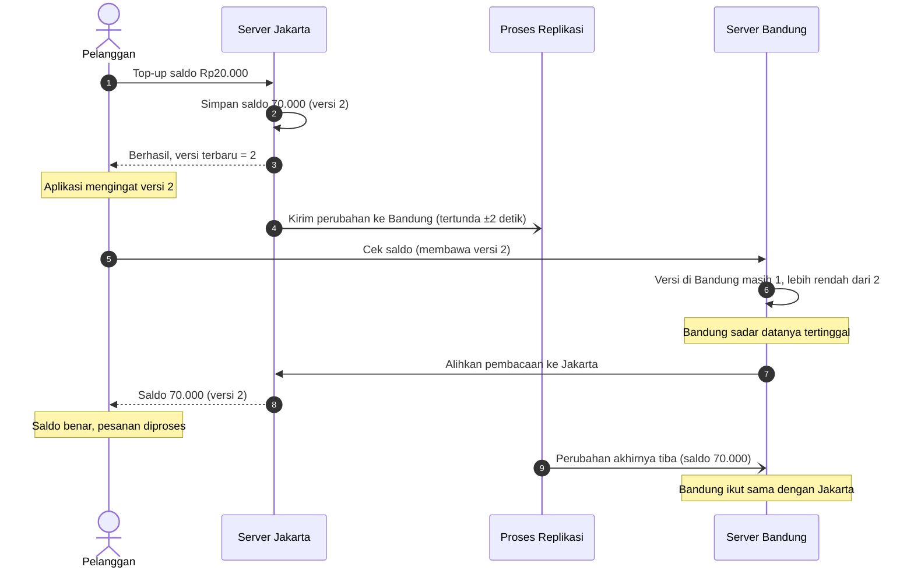

# Tugas 7 (Pekan 7) — Konsistensi Data

**Materi terkait:** Data-Centric Consistency (Sequential, Eventual), Client-Centric Consistency.

**Kelompok:** [Kelompok 5]

| Nama | NIM |
|---|---|
| [Bethari Nevyta Amaries] | [103072430016] |
| [A'ilah Nailul Fa'izah] | [103072400042] |

## Studi Kasus

Data saldo *e-wallet* pelanggan FoodGo berbeda antara server wilayah **Jakarta** dan **Bandung** karena replikasi antar server berjalan lambat. Contoh kasus nyata: pelanggan top-up saldo lewat server Jakarta, lalu dalam hitungan detik memesan makanan lewat aplikasi yang tersambung ke server Bandung — saldo belum ter-update, transaksi ditolak padahal saldo sebenarnya cukup.

## Pemilihan Model Konsistensi
Kelompok kami membandingkan dua model konsistensi, yaitu Sequential Consistency dan Eventual Consistency. Sequential Consistency menjamin semua server melihat urutan perbuahan yang sama. Kelebihannya yaitu data lebih terjaga, sedangkan kekurangannya yaitu harus menungu koordinasi antar server pada setiap transaksi. Sebaliknya, Eventual Consistency akan membiarkan data diperbarui secara bertahap tanpa menunggu semua server sama, sehingga lebih cepat dan lebih ringan. Kekurangannya yaitu data di satu server bisa berbeda dengan server lain untuk sementara waktu.

Untuk kasus FoodGo, saldo e-wallet merupakan data uang dimana ini merupakan data yang sensitif, jika terjadi pembacaan yang salah pada saldo maka akan langsung berdampak ke pelanggan dan bisnis. Hal ini dapat menyebabkan false rejection, resiko terjadi double-spend, serta transaksi yang gagal harus ditangani secara manual. 

Tapi penggunaan Sequential Consistency untuk semua data juga terlalu berat, setiap top-up dan pnegecekan saldo harus menungggu koordinasi antara Jakarta-Bandung, hal ini dapat menyebabkan latensi naik untuk semua pelanggan. 

Kami menyimpulkan bahwa model Eventual Consistency saja tidak cukup,  karena pelanggan masih bisa membaca saldo lama dari bandung setelah top up di jakarta. Tapi menggunakan Sequential Consistency penuh juga tidak diperlukan, karena pelanggan perlu melihat hasil operasinya sendiri. Karena itu kami memilih Eventual Consistency yang dilengkapi Client-Centric Consistency (Read-Your-Writes), cara ini menjaga performa dan ketersediaan seperti Eventual Consistency, tetapi menjamin pelanggan selalu melihat saldo terbarunya sendiri

## Usulan Solusi Client-Centric
Solusi yang kami usulkan adalah Read-Your-Writes dengan bantuan nomor verrsi. Setiap kali saldo berubah, perubahan tersebut diberi nomor versi yang terus bertambah. Aplikasi pelanggan menginbgat nomor versi terakhir dari saldo miliknya, lalu membawanya setiap kali membaca saldo.

Langkah kerjanya:

1. Pelanggan top-up lewat Jakarta. Jakarta menyimpan saldo baru dan memberi nomor versi baru, misalnya versi 2.
2. Aplikasi pelanggan mengingat bahwa versi terbaru miliknya adalah versi 2.
3. Jakarta mengirim perubahan ke Bandung di belakang layar. Proses ini butuh waktu beberapa detik.
4. Saat pelanggan memesan makanan lewat Bandung, aplikasi menyertakan nomor versi 2. Bandung lalu mengecek apakah datanya sudah mencapai versi 2.
5. Jika sudah, Bandung langsung menjawab. Jika belum, pembacaan dialihkan ke Jakarta yang sudah memiliki data terbaru.
6. Pesanan pelanggan diproses dengan saldo yang benar.


Solusi ini kami anggap konkret karena mudah diterapkan. Sistem hanya butuh satu nomor versi untuk tiap data dan satu tambahan informasi saat membaca, tanpa perlu mengubah cara replikasi berjalan. Pada kondisi normal, pembacaan tetap cepat karena dilayani server terdekat. Pengalihan ke Jakarta hanya terjadi ketika Bandung memang belum terbarui. Cara ini juga sudah kami buktikan lewat simulasi.

Kelebihan dari solusi ini adalah pelanggan selalu melihat saldo terbarunya sendiri, tidak perlu menunggu koordinasi antar server, dan mudah diterapkan. Kekurangannya yaitu pengalihan ke Jakarta membuat pembacaan sedikit lebih lama, Jakarta bisa jadi titik beban jika banyak redirect, dan jaminannya hanya berlaku per klien, bukan global antar-klien

## Sequence Diagram

### Skenario 1: Tanpa jaminan konsistensi (bug terjadi)


Titik kegagalan berada pada langkah 6, saat bandung melayani pembacaan sebelum update replikasi tiba, sehingga mengembalikan saldo 0 padahal saldo sebenarnya 50.000

### Skenario 2: Dengan Read-Your-Writes (bug teratasi)



Titik perbaikan terjadi pada langkah 6 dan 7, Bandung mendeteksi replikanya tertinggal, lalu mengalihkan pembacaan ke Jakarta. Dengan begitu pelanggan tidak pernah melihat data lama miliknya sendiri.

## Simulasi

Kami membuat simulasi di `src/replica_simulation.py` dengan dua server, yaitu Jakarta dan Bandung. Keterlambatan replikasi kami buat sendiri selama 2 detik supaya masalahnya bisa terlihat jelas.

### Hasil skenario naif (tanpa Read-Your-Writes)

```text
[Jakarta] WRITE saldo user1 = 50000.0 (versi 1)
[TODO] Replikasi ke Bandung akan tertunda 2.0 detik
Baca saldo dari Bandung (naif): 0.0
-> Harusnya 50000, tapi karena delay replikasi, hasilnya bisa 0 (BUG)
[Bandung] WRITE saldo user1 = 50000.0 (versi 1)
```

Setelah top-up Rp50.000 di Jakarta, saldo langsung dibaca dari Bandung hanya 0,5 detik kemudian. Hasilnya 0, bukan 50.000. Perubahan ke Bandung baru masuk setelah saldo terbaca. Ini membuktikan bahwa masalah saldo lama terbaca memang terjadi.

### Hasil skenario Read-Your-Writes

```text
[Jakarta] WRITE saldo user1 = 70000.0 (versi 2)
[TODO] Replikasi ke Bandung akan tertunda 2.0 detik
[RYW] Versi data di Bandung masih 1
[RYW] Versi minimal yang dibutuhkan: 2
[RYW] Mengalihkan pembacaan ke server Jakarta
[RYW] Saldo user1 dibaca dari Jakarta: 70000.0 (versi 2)
Baca saldo dengan Read-Your-Writes: 70000.0
-> Saldo terbaru tetap terbaca meskipun replikasi belum selesai.
[Bandung] WRITE saldo user1 = 70000.0 (versi 2)
```

Pada skenario ini, Bandung masih di versi 1 padahal pelanggan membutuhkan minimal versi 2. Sistem menyadari hal itu lalu mengalihkan pembacaan ke Jakarta, sehingga saldo yang terbaca benar, yaitu 70.000. Setelah beberapa detik, Bandung ikut terbarui ke versi 2.

### Perbandingan

| Skenario | Saldo seharusnya | Saldo yang terbaca | Hasil |
|---|---|---|---|
| Naif (baca dari Bandung) | 50.000 | 0 | Salah |
| Read-Your-Writes (dialihkan ke Jakarta) | 70.000 | 70.000 | Benar |

## Struktur Submission

```
tugas-07-konsistensi-data/
├── README.md      # Analisis konsistensi + sequence diagram Mermaid
├── JURNAL.md
├── src/            # (opsional) simulasi replikasi
└── bukti/          # (jika mengerjakan simulasi) output program
```

## Rubrik Penilaian (Tugas 7)

| Komponen | Bobot | Kriteria |
|---|---|---|
| Ketepatan pemilihan model konsistensi | 30% | Argumen berbasis dampak bisnis nyata, bukan hafalan definisi |
| Kualitas sequence diagram | 30% | Menunjukkan jelas titik kegagalan & titik perbaikan |
| Usulan solusi client-centric | 25% | Solusi konkret dan dapat diimplementasikan (bukan wacana abstrak) |
| Proses & kontribusi kelompok | 15% | `JURNAL.md`, commit history (+ bonus jika simulasi dikerjakan) |

## Batasan Penggunaan AI (Level 2)

Kebijakan **Level 2 (AI Assisted Idea Generation & Structuring)** berlaku — lihat [`../RUBRIK-UMUM.md`](../RUBRIK-UMUM.md). Boleh bertanya konsep umum consistency model ke AI untuk brainstorming; **tidak boleh** meminta AI menuliskan analisis akhir/sequence diagram atau isi `# TODO` di `src/replica_simulation.py` yang tinggal ditempel. Catat pemakaian AI di "Log Penggunaan AI" pada `JURNAL.md`.

- Sebagai bukti pemahaman konsep (bukan hafalan jawaban skenario FoodGo saja), `README.md` wajib menyertakan **satu skenario tambahan** yang kalian buat sendiri (mis. kasus lain di aplikasi ojek online) dan menentukan model konsistensi yang tepat untuk skenario tambahan tersebut.
